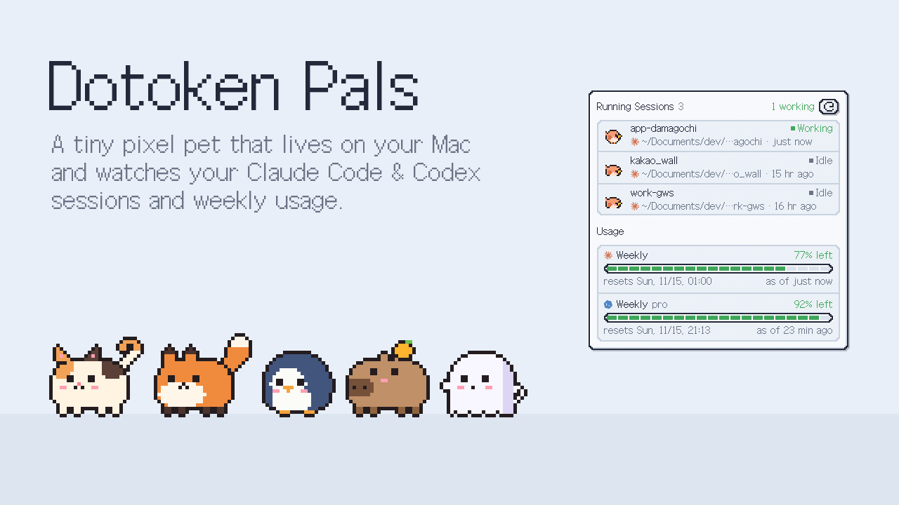
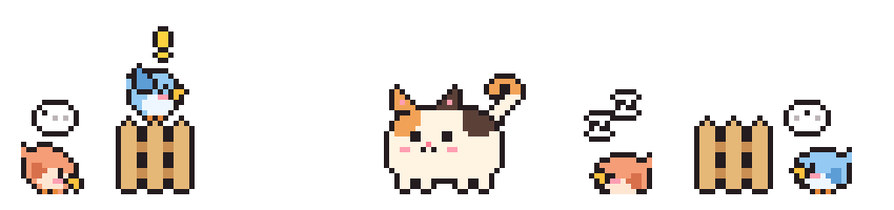
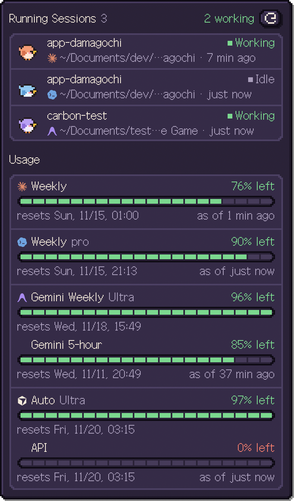
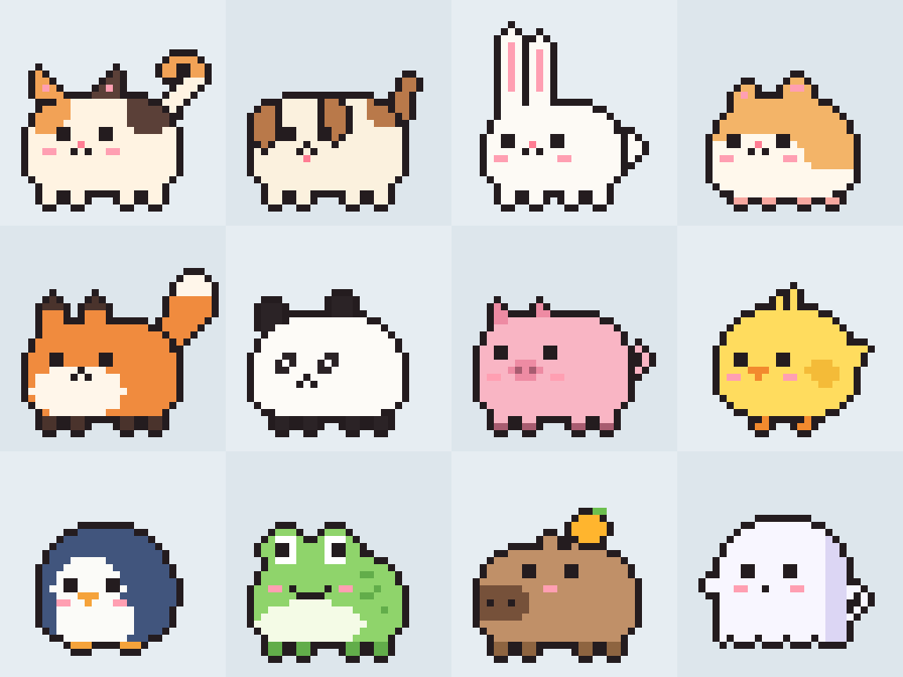
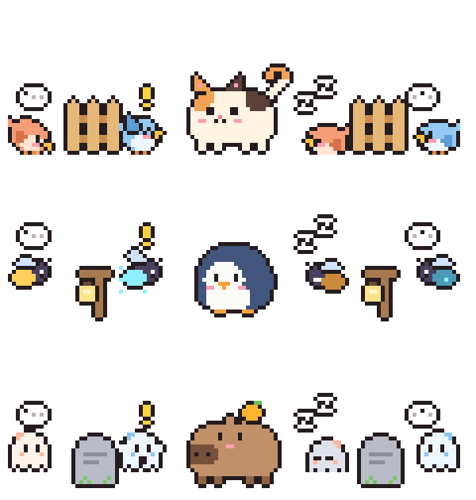
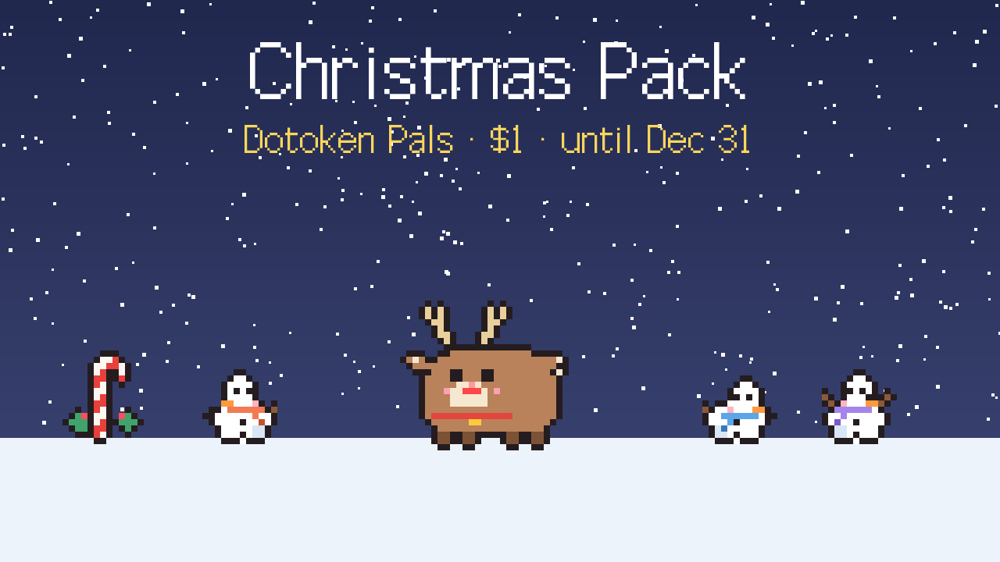

# Dotoken Pals



Your token usage, but make it cute. A tiny pixel pal lives at the bottom of your Mac screen and tells you how much usage you have left and which AI sessions are busy.

Works with **Claude Code**, **Codex**, **Antigravity** and **Cursor**. Website: [dotoken-pals.vercel.app](https://dotoken-pals.vercel.app)

**[⬇ Download for Mac (free)](https://github.com/Canine89/dotoken-pals-releases/releases/latest/download/DotokenPals.dmg)** · **[Get Pro ($7.99)](https://2031900017128.gumroad.com/l/dotokenpals)** · macOS 13+ · Apple Silicon & Intel

## What it does

- **Click the pet** to see every running session (Claude Code, Codex, Antigravity CLI `agy`) and how much usage is left on Claude Code, Codex, Antigravity and Cursor.
- **One bird per session.** Orange for Claude Code, blue for Codex, purple for Antigravity. It flies in when a session starts and away when it ends. It pecks while working, hops with a `!` when it needs your input, and dozes when idle.
- A speech bubble shows your remaining usage every so often.
- English, 한국어, 日本語, 简体中文 · light & dark.
- Sessions and usage are read locally and never leave your Mac. Cursor usage is optional: when you turn it on, the app asks Cursor's own server using your Cursor login.





## Free vs Pro

| | Free | Pro |
|---|---|---|
| Sessions, usage panel, speech bubbles | ✓ | ✓ |
| Pets | cat, dog, chick | + rabbit, hamster, fox, panda, pig, penguin, frog, capybara, ghost |
| Session pal themes | birds | + fireflies, ghosts |
| Choose your pet's personality | | ✓ |
| Fence (keep your pet inside a range) | | ✓ |





Pro is a one-time purchase for 2 Macs, with free updates — [get it on Gumroad](https://2031900017128.gumroad.com/l/dotokenpals). Activate it from the menu bar: **Activate Pro…**

### Season packs ($1 each)



Limited packs with a new pet, session pals and a fence, sold only during their season: Christmas (Nov 11 – Dec 31), Lunar New Year, Sakura, Summer, Moon Festival and Halloween. No Pro needed, and a pack you buy is yours to keep. Find them in the menu bar under **Season Packs…** while they're on sale.

## Install

1. Download **DotokenPals.dmg** and open it.
2. Drag **Dotoken Pals** into **Applications**, then open it.
3. For Claude Code or Antigravity usage, do the one-minute setup below. Cursor usage is turned on from the panel or the menu.

The app downloads new versions by itself and installs them when it restarts.

### Claude Code usage setup (1 minute)

Sessions and Codex usage work right after installing. **Claude Code's weekly usage** needs a one-time setup: it connects the limit info Claude Code passes to its statusline so the app can read it.

Open `~/.claude/settings.json` and follow whichever case applies to you.

**If you don't use a custom statusline**, add this:

```json
{
  "statusLine": {
    "type": "command",
    "command": "sh /Applications/DotokenPals.app/Contents/Resources/claude-statusline-hook.sh"
  }
}
```

**If you already have a statusline**, put the hook **in front of** your existing `command`. Your statusline keeps looking the same.

```json
"command": "sh /Applications/DotokenPals.app/Contents/Resources/claude-statusline-hook.sh bash ~/.claude/statusline-command.sh"
```

Replace `bash ~/.claude/statusline-command.sh` in the example with the command you were already using.

Save, then send one message in Claude Code. Your weekly usage appears in the panel and updates automatically every time Claude Code responds.

> Limit info is provided when you sign in to Claude Code with a Claude subscription. It may not appear if you use an API key.

### Antigravity usage setup (1 minute)

If you use the **Antigravity CLI (`agy`)**, open `~/.gemini/antigravity-cli/settings.json` and add:

```json
"statusLine": {
  "type": "command",
  "stack_with_default": true,
  "command": "sh /Applications/DotokenPals.app/Contents/Resources/antigravity-statusline-hook.sh"
}
```

`stack_with_default` keeps agy's own status line. Your Gemini quota shows up the next time `agy` runs.


---

이 저장소는 Dotoken Pals 배포 파일만 올리는 곳입니다. 앱은 무료로 받고, Pro는 Gumroad에서 살 수 있습니다.

Claude is a trademark of Anthropic, PBC. Codex is a trademark of OpenAI. Antigravity and Gemini are trademarks of Google LLC. Cursor is a trademark of Anysphere, Inc. Dotoken Pals is an independent app, not affiliated with any of them.
© 2026 Hyun Gyu Park.
